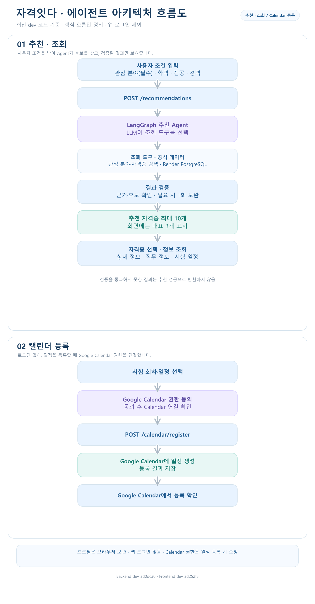

# 자격잇다 — 발표용 README

## 1. 프로젝트 한 줄 소개

자격잇다는 관심 분야와 사용자 조건에 맞는 자격증을 탐색하고, 공식 시험 정보와 일정을 확인해 원하는 시험 일정을 Google Calendar에 등록하도록 돕는 서비스입니다.

‘자격잇다’라는 이름에는 자격증 탐색부터 시험 일정 관리까지 사용자의 준비 과정을 이어 준다는 의미를 담았습니다.

## 2. 서비스 개요

사용자는 자격증을 검색하거나 프로필 조건으로 추천을 받고, 자격증 상세 정보와 회차별 시험 일정을 살펴본 뒤 원하는 항목만 Google Calendar에 등록할 수 있습니다. 추천은 탐색을 위한 참고 결과이며, 공식 응시 가능 여부를 판정하지 않습니다.

앱 로그인은 현재 범위에서 제외되어 있습니다. 프로필은 프론트엔드 브라우저에 저장되고 추천 요청에 포함됩니다. Google Calendar 권한은 앱 로그인과 별도로, 일정 등록을 시작할 때 동의받습니다.

## 3. 사용자 페르소나

| 사용자 유형 | 대표 사용자 | 핵심 요구 |
| --- | --- | --- |
| 자격증 탐색형 | 이수진 | 자신의 조건에 맞는 자격증을 찾고 싶음 |
| 시간 부족형 | 조희원 | 직장생활과 병행 가능한 시험정보와 준비방향이 필요함 |
| 목표 명확형 | 윤지민 | 정한 자격증의 시험회차와 준비정보를 정리하고 싶음 |

자격증 탐색형은 선택지가 많아 자신에게 맞는 후보를 찾기 어렵고, 시간 부족형은 흩어진 시험 정보를 따로 모으는 부담이 있습니다.
목표 명확형에게도 회차별 일정을 한곳에서 관리할 필요가 있어, 자격잇다는 조건 기반 추천부터 공식 정보 확인과 Calendar 등록까지 한 흐름으로 연결합니다.

세 페르소나는 서로 다른 서비스를 쓰는 것이 아니라, 같은 핵심 기능을 서로 다른 상황에서 이용합니다.

### 추천 입력 규칙

| 입력 | 현재 규칙 |
| --- | --- |
| 관심 분야 | 필수. 서비스 분야 코드 01~24 중 정확히 하나 선택 |
| 최종 학력 | 필수 선택값 |
| 졸업 상태 | 필수 선택값 |
| 전공 | 선택 입력 |
| 관련 경력 여부 | 필수 선택 |
| 경력 연수 | 경력이 있다고 선택한 경우 필수 숫자 입력 |

## 4. 주요 기능

아래 표는 요청하신 PRD 기능 목록입니다. 요구사항과 현재 구현 상태의 차이는 마지막 절에 따로 정리했습니다.

| 우선순위 | 기능 | 설명 |
| ---- | ------------------------- | --------------------------------------------- |
| P0   | 비로그인 자격증 탐색               | 시작 화면에서 자격증 목록과 검색 제공                         |
| P0   | Google 로그인·Calendar 권한 동의 | 로그인 과정에서 서비스 인증과 Calendar 권한을 함께 요청           |
| P0   | 희망 분야·기본 정보 입력            | 관심 분야를 필수로 받고, 사용자 기본 정보를 저장                  |
| P0   | 자격증 추천                    | 관련 후보를 최대 10개까지 제공하고 화면에는 처음 3개 표시            |
| P0   | 추천 자격증 더 보기               | 동일한 추천 응답에서 나머지 후보 표시. 더보기 클릭으로 새 추천을 실행하지 않음 |
| P0   | 추천 이유 제공                  | 관심 분야와 검수된 직무 근거, 입력한 사용자 배경을 바탕으로 설명         |
| P0   | 자격증 상세 조회                 | 시험과목·합격기준·응시료·관련 직무·공식 출처 제공                  |
| P0   | 시험 회차 선택                  | 연도·회차·필기/실기 등 단계별 일정 확인 및 선택                  |
| P0   | Calendar 등록 내용 확인         | 등록할 일정과 날짜를 화면에서 미리 확인                        |
| P0   | Google Calendar 등록        | 사용자의 최종 확인 후 선택한 일정 등록                        |
| P0   | 내 등록 일정 조회                | 자격잇다에서 등록한 시험 관련 일정을 조회                       |
| P0   | Agent 결과 검증·오류 처리         | 도구 선택, 결과 검증, 제한된 재실행과 실패 안내                  |

## 5. 화면 설계서

https://app.notion.com/p/yleeylee/3f82b0d658a680118f54e049de1f4dd4?source=copy_link

## 6. 에이전트 흐름도

현재 코드에 구현된 추천 흐름입니다. 모델이 추천 후보를 판단하고, Python 코드가 조회 도구를 실행하고 결과를 검증합니다.

State는 한 번의 추천 요청 안에서 프로필, 메시지, 검색 후보, 도구 호출, 오류·재시도 횟수와 결과를 보관합니다. 실제 조회 도구는 관심 분야 목록 조회와 자격증 후보 검색이며, 결과가 검증되지 않으면 성공 응답 대신 실패 경로로 종료합니다. 장기 기억, 전용 벡터 RAG, 일반적인 자기성찰 기능은 구현 완료로 보지 않습니다.

## 7. 구현하지 않은 기능 및 확인 필요

| 항목 | 현재 상태 |
| --- | --- |
| Google 서비스 로그인과 Calendar 권한을 한 번에 동의 | 미구현. 앱 로그인은 현재 범위에서 제외하고 Calendar OAuth는 일정 등록 시 별도로 진행 |
| 서버 사용자 계정·프로필 저장 | 미구현. 프로필은 브라우저 localStorage에 저장 |
| Calendar 등록 이력 조회 API | 미구현. 화면의 등록 요약은 브라우저에 보관한 결과를 사용하며 실제 일정은 Google Calendar에서 확인 |
| 공식 응시자격 가능·불가 판정 | 미구현. 추천은 탐색 후보이며 공식 판정이 아님 |
| Agent 추가 질문·장기 기억·전용 RAG 및 전후 성능 비교 | 미구현 또는 별도 평가 필요 |
| 로그인 잔여 호출 | 프론트 시작 코드에 /auth/refresh 호출이 남아 있음. 현재 백엔드에 경로가 없어 404가 날 수 있어 정리 필요 |
| Render DB 마이그레이션·실계정 Calendar 통합·배포 | 이 README 작성 과정에서 실제 DB·Google 계정·배포 상태를 재검증하지 않음 |

구현 근거와 API·DB 상세는 [API 설계서](backend/docs/API_설계서.md), [데이터베이스 설계서](backend/docs/데이터베이스_설계서.md), [팀 공유 문서](backend/docs/팀_공유문서.md)를 참고합니다.
